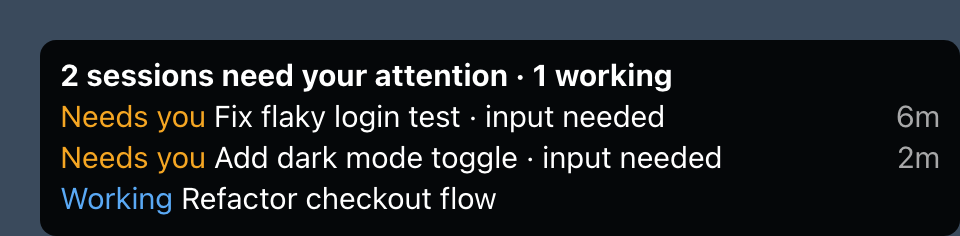

# ubersicht-widgets

My collection of [Übersicht](http://tracesof.net/uebersicht/) widgets.

## [claude-sessions.widget](claude-sessions.widget)

Live status of your Claude Code sessions: which need your attention, which are working, which have finished.

More states (working, all done, overflow) are in [examples/](examples).
